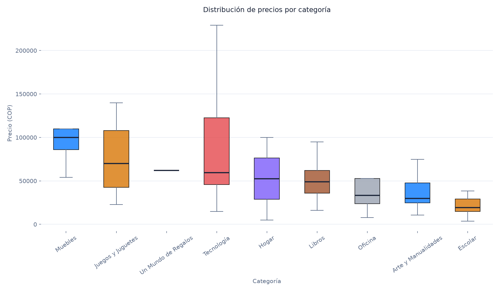
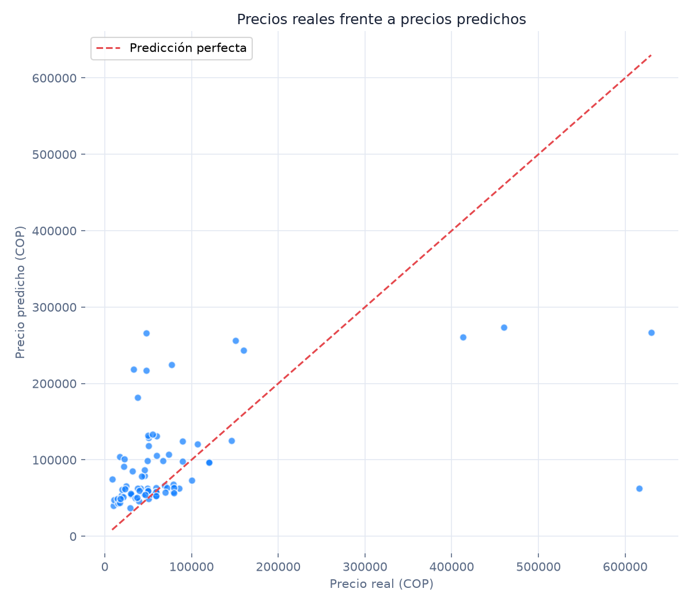
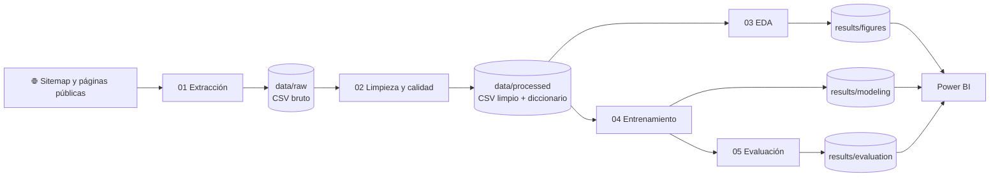
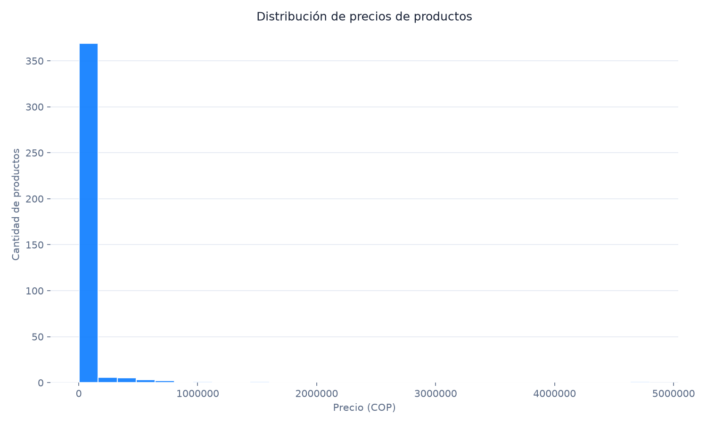
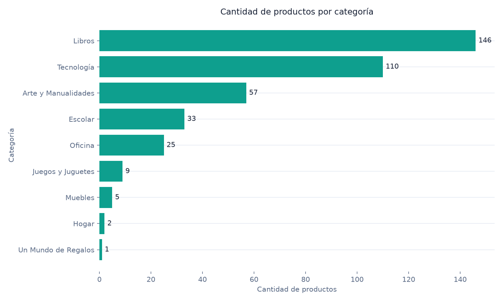
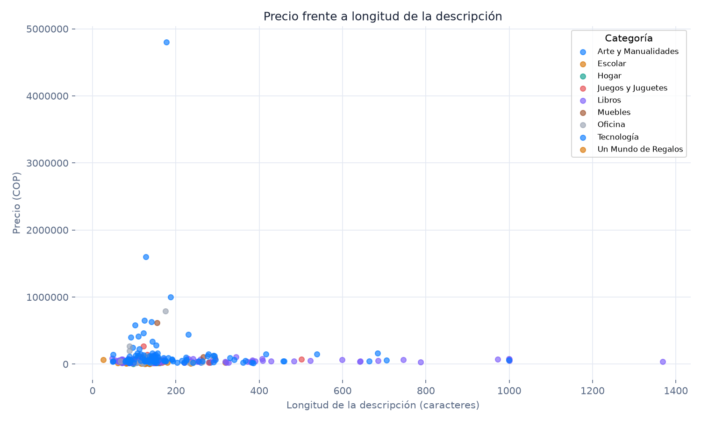
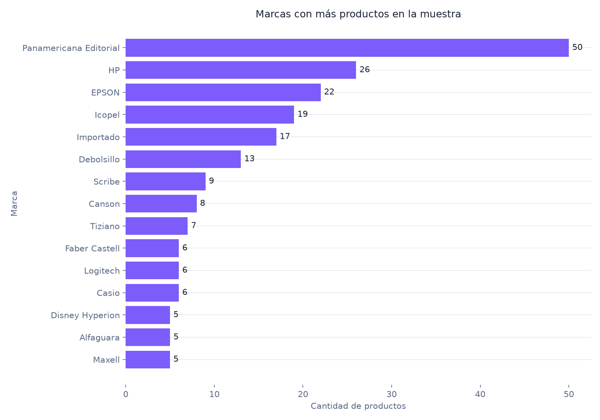
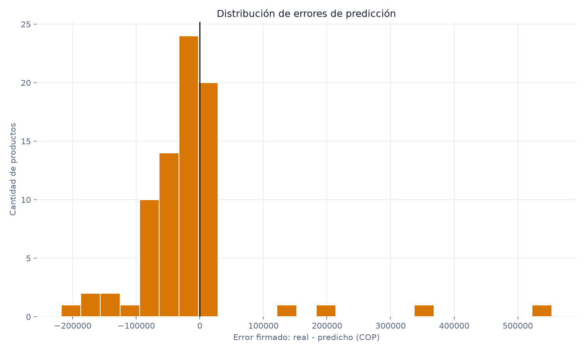
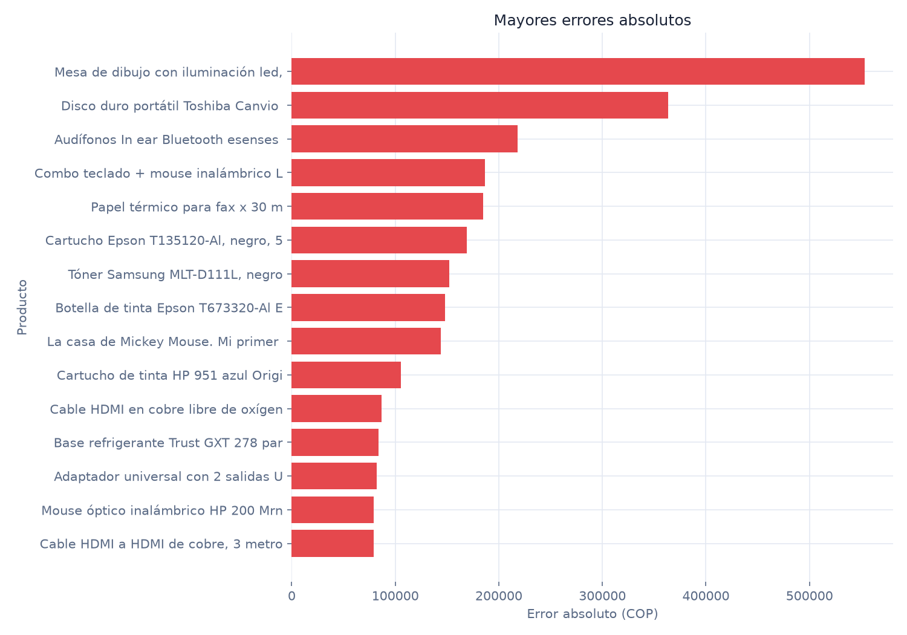
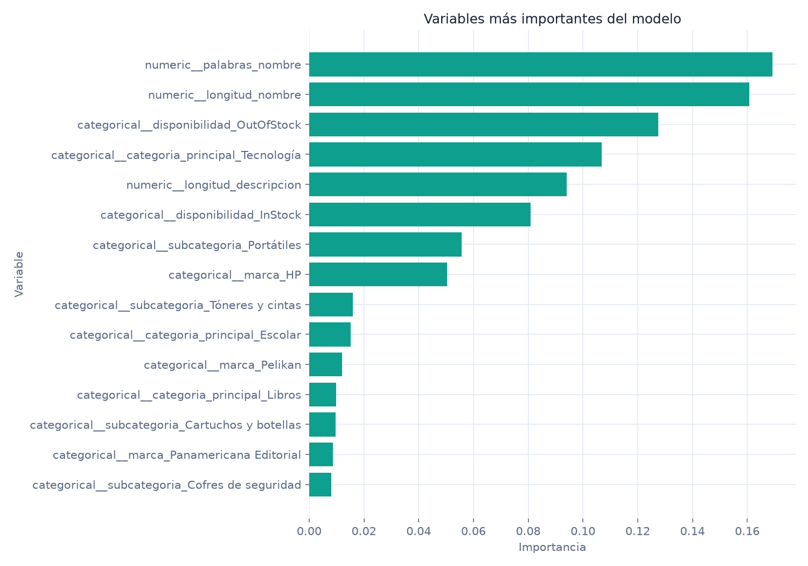

# Panamericana | Web Scraping, EDA & Machine Learning

<p align="center">
  
  
</p>


<p align="center">
  
  
  
  
  
</p>

##  Resumen

Este proyecto analiza productos publicados en [Panamericana Colombia](https://www.panamericana.com.co/).
El flujo obtiene información pública desde el sitemap y las páginas de producto,
la transforma en un catálogo confiable, encuentra patrones de precio y entrena
un modelo de **Random Forest Regressor** para estimar `precio_cop`.

##  Resultados principales

| Indicador | Resultado |
|---|---:|
| Productos extraídos y válidos | **388** |
| Variables del dataset limpio | **13** |
| Categoría con más productos | **Libros (146)** |
| Precio mínimo | **$3.600 COP** |
| Precio mediano | **$47.650 COP** |
| Precio máximo | **$4.799.000 COP** |
| Registros de entrenamiento / prueba | **310 / 78** |
| MAE del modelo | **$54.199,75 COP** |
| RMSE del modelo | **$98.447,05 COP** |
| R² del modelo | **0,2213** |

El modelo supera a la línea base en RMSE y R². El MAE debe interpretarse junto
con la alta dispersión del catálogo: existen productos de bajo costo y algunos
artículos de precio excepcionalmente alto.

##  Flujo del proyecto



##  Estructura organizada

```text
scraping/
├── README.md                         # Documentación y resultados finales
├── requirements.txt                  # Dependencias reproducibles
├── extract_panamericana.py           # Web scraping público
├── data/
│   ├── raw/                          # Dataset original publicado
│   └── processed/                    # Dataset limpio, calidad y diccionario
├── cleaning/
│   └── prepare_data.py               # Validación, limpieza e ingeniería básica
├── analysis/
│   ├── run_eda.py                    # Orquestador de gráficas
│   └── graficas/                     # Visualizaciones exploratorias
├── modeling/
│   └── train_model.py                # Pipeline Random Forest
├── evaluation/
│   └── evaluate_model.py             # Métricas, errores y tablas Power BI
├── results/
│   ├── figures/                      # Resultados del EDA
│   ├── evaluation/                   # Resultados del modelo
│   ├── modeling/                     # Métricas, modelo y predicciones
│   └── power_bi/                     # Tablas listas para el dashboard
├── dashboard/                        # Tema, guía y maqueta de Power BI
└── Entregable/                       # Exportación histórica de la entrega
```

La carpeta `Entregable/` se conserva como respaldo compatible con la entrega
original. La fuente canónica para reproducir el proyecto son las carpetas
`data/`, `analysis/`, `cleaning/`, `modeling/`, `evaluation/` y `results/`.

##  Dataset público

Los datos quedan visibles y versionables en estas rutas:

- [Dataset bruto](data/raw/panamericana_products.csv): registros tal como fueron extraídos.
- [Dataset limpio](data/processed/panamericana_products_clean.csv): versión usada en el análisis y el modelo.
- [Reporte de calidad](data/processed/quality_report.json): filas, nulos, duplicados y distribución de precios.
- [Diccionario de datos](data/processed/data_dictionary.csv): significado y tipo de cada columna.
- [Predicciones de prueba](results/modeling/test_predictions.csv): valor real, predicción y error.
- [Métricas del modelo](results/modeling/metrics.json): configuración y métricas reproducibles.

### Variables más importantes

El modelo utiliza marca, categoría, subcategoría, disponibilidad y variables
derivadas del texto (`longitud_nombre`, `palabras_nombre`,
`longitud_descripcion`). Las variables con mayor importancia fueron:

1. `palabras_nombre`
2. `longitud_nombre`
3. `disponibilidad`
4. `categoria_principal`
5. `longitud_descripcion`

Importancia no significa causalidad: indica cuánto contribuyó cada variable a
las decisiones del Random Forest en este conjunto de datos.

##  Galería de resultados

### Análisis exploratorio

<p align="center">
  
  
  
  
</p>

### Evaluación del modelo

<p align="center">
  
  
  
</p>

## ▶️ Reproducción local

En Windows, desde la raíz del proyecto:

```powershell
python -m venv .venv
.\.venv\Scripts\Activate.ps1
pip install -r requirements.txt

python extract_panamericana.py --limit 5000 --delay 0.2
python cleaning\prepare_data.py
python analysis\run_eda.py
python modeling\train_model.py
python evaluation\evaluate_model.py
```

Si ya se cuenta con el dataset incluido, se pueden omitir el primer comando de
extracción y ejecutar desde `cleaning\prepare_data.py`. La extracción depende
de la disponibilidad actual del sitio y puede producir una muestra diferente
con el paso del tiempo.

##  Power BI

El dashboard puede construirse con:

- [Guía de Power BI](dashboard/POWER_BI_GUIDE.md)
- [Tema JSON](dashboard/Dashboard%20Panamericana.json)
- [Medidas DAX](dashboard/medidas_dax.txt)
- [Maqueta visual](dashboard/dashboard_maqueta_pag_1.png)
- [Archivo editable PBIX](Entregable/10_Archivo_powerbi_Panamericana_Juan_Martinez.pbix)

Las tablas preparadas para cargar directamente se encuentran en
[`results/power_bi/`](results/power_bi/).

## 🏛️ Arquitectura utilizada

La organización sigue una arquitectura **por etapas de un pipeline de datos
(ETL + analítica + ML)**, con separación entre código, datos y artefactos:

1. **Ingesta:** `extract_panamericana.py` obtiene datos públicos y los guarda en
   `data/raw/`.
2. **Transformación:** `cleaning/prepare_data.py` valida columnas, normaliza
   texto, elimina registros inválidos o duplicados y genera el reporte de
   calidad.
3. **Analítica:** `analysis/` contiene el EDA y produce figuras reutilizables.
4. **Modelado:** `modeling/train_model.py` encapsula preprocesamiento y
   Random Forest en un pipeline de scikit-learn.
5. **Evaluación:** `evaluation/evaluate_model.py` genera métricas, gráficos de
   error y tablas para Power BI.
6. **Consumo:** `results/` y `dashboard/` contienen salidas listas para
   inspección, presentación y toma de decisiones.

Es una arquitectura **modular, reproducible y orientada a artefactos**:
cada etapa tiene una responsabilidad, usa rutas relativas a la raíz y entrega
salidas que pueden inspeccionarse sin abrir el código. No es una arquitectura
de microservicios; para este proyecto offline y analítico, un pipeline
secuencial por capas evita complejidad innecesaria.

## ⚖️ Alcance y uso responsable

- La información corresponde a páginas públicas y puede cambiar después de la fecha de extracción.
- El dataset es un snapshot académico, no una fuente oficial de precios vigentes.
- El modelo sirve para exploración y apoyo analítico; no reemplaza la verificación del precio publicado.
- Respeta los términos de uso, frecuencia de solicitudes y disponibilidad del sitio de origen.

## 👤 Autor

**Juan Martínez** · Proyecto académico de análisis de datos y web scraping.
